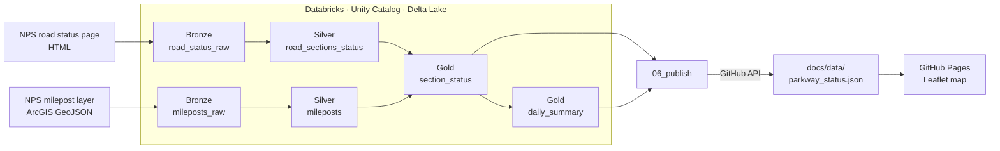

# Blue Ridge Parkway Road Status: Databricks Pipeline & GIS Map

**Live map:** https://marcusdenice.github.io/blue-ridge-parkway-closures/
A daily data pipeline that collects the National Park Service's road status for the 469-mile Blue Ridge Parkway, refines it through a **bronze → silver → gold medallion architecture in Databricks**, and publishes an interactive map to **GitHub Pages**.

> ⚠️ **Not for navigation.** This is a portfolio project. Always confirm conditions with the official [NPS road status page](https://www.nps.gov/blri/planyourvisit/roadclosures.htm).

---

## What it does

Every morning at 9:00 (America/New_York) a Databricks job:

1. **Downloads** the NPS road status page
2. **Parses** its Virginia and North Carolina tables into one clean row per parkway section
3. **Classifies** each section as *open*, *reduced* (lane closures / delays), *closed*, or *unknown*
4. **Builds map lines** for every section from NPS milepost coordinates (linear referencing)
5. **Checks** the data and stops if anything looks wrong, so bad data is never published
6. **Publishes** one JSON file to this repo, which the website reads

The website shows miles open / reduced / closed, a map colored by status, and a list of sections that aren't fully open.

---

## Architecture



**Why two platforms:** Databricks does the processing (and stays private, as real data platforms do); GitHub Pages hosts the result for free, so anyone can open it from a link.

---

## Medallion design

The project is built for **current status only**: each table holds the latest run and is **overwritten only after the quality checks pass**, so a failed run never replaces good data. Delta Lake time travel still keeps recent table versions for debugging.

| Layer | Table | Contents |
|---|---|---|
| **Bronze** | `brp.bronze.road_status_raw` | The NPS page HTML exactly as downloaded, with URL, HTTP status, download time, and SHA-256 fingerprint |
| | `brp.bronze.mileposts_raw` | The NPS milepost layer as downloaded (GeoJSON text) |
| **Silver** | `brp.silver.road_sections_status` | One row per parkway section: state, milepost range, crossroads, NPS status text, classified status, gated flag |
| | `brp.silver.mileposts` | One point per whole milepost: longitude, latitude (reference data) |
| **Gold** | `brp.gold.section_status` | Each section with its status and map line (GeoJSON) |
| | `brp.gold.daily_summary` | Miles and percentages by status for the whole parkway, VA, and NC |

---

## Notebooks

| Notebook | Purpose |
|---|---|
| `00_setup` | Creates the catalog, schemas, and tables (safe to re-run) |
| `01_connectivity_test` | Confirmed Databricks Free Edition can reach every source |
| `02_bronze_ingest` | Downloads the road status page into bronze |
| `03_silver_road_sections` | Parses both state tables into clean sections, with quality checks |
| `04_reference_mileposts` | Downloads milepost coordinates (run on demand; reference data) |
| `05_gold` | Builds map lines and the status summary |
| `06_publish` | Exports gold to `docs/data/parkway_status.json` via the GitHub API |
| `99_git_test` | Tests that Databricks workspace can commit and push to the linked Git repository |

**Job:** `brp_daily_pipeline`: `bronze_ingest → silver_road_sections → gold → publish`, daily at 09:00, serverless compute, email on failure. Each task runs only if the previous one succeeded. Definition: [`jobs/brp_daily_pipeline.yml`](jobs/brp_daily_pipeline.yml).

---

## Data quality

Checks run before every write. **FAIL** checks stop the job; **WARN** checks are logged.

- **Every table row is accounted for:** each row extracted from the page is classified as a section, header, single-milepost row, or unparsed, and the counts must add up. Any unparsed row fails the run, so nothing is silently dropped.
- **Full coverage:** sections must run from milepost 0 to 469.1 with no gap or overlap larger than `GAP_TOLERANCE_MI` (0.2 mi).
- **Geography:** Virginia sections north of the state line (~MP 217), North Carolina south of it; every coordinate inside the parkway's bounding box (catches swapped longitude/latitude).
- **Geometry:** every section line is valid, and neighbouring sections connect end to end.
- **Mileposts:** expected point count, no duplicates, neighbouring points within 3 miles (haversine distance).
- **Status:** only known categories; unrecognized NPS wording is flagged as `unknown` with a warning.
- **Self-tests:** helper functions (milepost parsing, status rules, interpolation) are tested with `assert` before any data is processed.

---

## Design decisions

- **Columns read by position, not header name:** the two state tables use different header wording.
- **Status rules are ordered:** "Open with sporadic single lane closures" contains the word *closures*, so lane-closure wording is checked **before** "closed" to avoid marking open roads as closed.
- **Raw status kept alongside the classification** (`status_raw` vs `status`), so the rules can always be checked against the source.
- **Linear referencing:** sections are stored by milepost (e.g. 63.5–63.9) and placed on the map by interpolating between whole-mile reference points, the same technique used for highways and railways.
- **Current status only:** history isn't needed for the map, so tables are overwritten; storage stays constant.
- **Secrets:** the GitHub token lives in a Databricks secret scope, never in code. It is a fine-grained token limited to this repo's contents.
- **One published file:** everything the website needs is in a single JSON file, so the pipeline makes one commit per day, and skips the commit when nothing changed.

---

## Problems found along the way

- **Silently dropped row:** the first parser filtered and parsed in one step, so the first North Carolina row disappeared (a 12.8-mile coverage gap). The coverage check caught it; the fix was to extract every row first and require every row to be accounted for.
- **Source data error:** the NPS milepost layer had milepost 89 twice and 88 missing. Verified by distance from neighbouring points, then fixed with a documented correction targeted at that one feature, which warns if NPS fixes the source.

---

## Responsible scraping

- Checked `nps.gov/robots.txt`: the road status page is not disallowed.
- One request per day, with an identifying User-Agent.
- NPS content is U.S. government work; the source is credited and linked.

---

## Tech stack

**Databricks** (Free Edition, serverless) · **Unity Catalog** · **Delta Lake** · **Python** (requests, BeautifulSoup, pandas, PySpark) · **SQL** · **Databricks Jobs** · **ArcGIS REST API** · **GeoJSON** · **GitHub API** · **GitHub Pages** · **Leaflet** · **OpenStreetMap**

---

## Repository structure

```
notebooks/          Databricks notebooks (pipeline numbered in run order)
jobs/               Databricks job definition (YAML)
docs/               GitHub Pages website
  index.html        page structure
  style.css         styles
  app.js            loads the data, draws the map
  data/             parkway_status.json (written daily by the pipeline)
```

## Run it yourself

1. Create a Databricks workspace (Free Edition works) and connect this repo as a **Git folder**.
2. Run `00_setup`, then `04_reference_mileposts` once.
3. Create a fine-grained GitHub token (this repo, Contents: read and write) and store it as the Databricks secret `brp/github_token`.
4. Set `GITHUB_OWNER` in `06_publish`.
5. Create the job from `jobs/brp_daily_pipeline.yml` (or run notebooks `02` → `06` in order).
6. In the repo's **Settings → Pages**, deploy from branch `main`, folder `/docs`.

---

## Limitations and ideas

- Single-milepost rows (spot closures) are set aside rather than mapped as points.
- The parser depends on the NPS page layout; a redesign would fail the checks (by design) and need parser updates.
- Ideas: keep history for seasonal analysis, define the job as code with Declarative Automation Bundles, add weather data.

---

## Credits

Road status and milepost data: **National Park Service**, Blue Ridge Parkway · Basemap: **© OpenStreetMap contributors** · Map library: **Leaflet**

## License

MIT, see [LICENSE](LICENSE).
